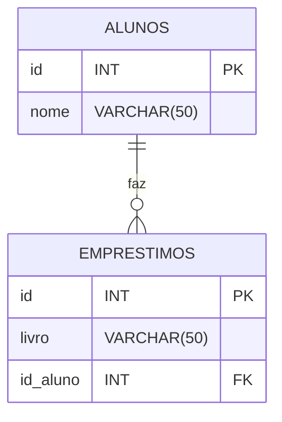
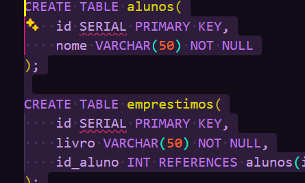
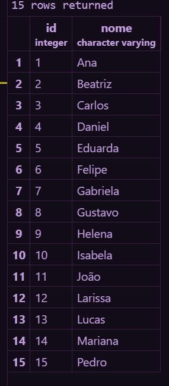

## Relacionamento entre tabelas
A ideia central, é relacionar duas tabelas distintas.

---

## Diagrama


---

1- Primeiro foi criada a tabela alunos:
```sql

CREATE TABLE alunos(
    id SERIAL PRIMARY KEY,
    nome VARCHAR(50) NOT NULL
);

```

---

2- Criei a tabela EMPRESTIMOS com referencia a coluna ID da tabela alunos:
```sql

CREATE TABLE emprestimos(
    id SERIAL PRIMARY KEY,
    livro VARCHAR(50) NOT NULL,
    id_aluno INT REFERENCES alunos(id)
);

```

---

3- Inserindo as informações na tabela:
```sql

INSERT INTO alunos (nome) VALUES

('Ana'),

('Beatriz'),

('Carlos'),

('Daniel'),

('Eduarda'),

('Felipe'),

('Gabriela'),

('Gustavo'),

('Helena'),

('Isabela'),

('João'),

('Larissa'),

('Lucas'),

('Mariana'),

('Pedro');

```

---

4- Para aparecer os alunos:
```sql
SELECT * FROM alunos;

```

---

5- Inserindo as informações da tabela emprestimos:
```sql
INSERT INTO emprestimos(livro,id_aluno) VALUES

('Harry Potter',1),

('O Pequeno Príncipe',2),

('Turma da Mônica',3),

('Dom Casmurro',4),

('Percy Jackson',5),

('Extraordinário',6),

('O Hobbit',7),

('A Culpa é das Estrelas',8),

('Diário de um Banana',9),

('As Crônicas de Nárnia',10);

```

---

6- Consultando os empréstimos:
```sql
SELECT * FROM emprestimos;

```

---

7- Consultando os empréstimos com INNER JOIN:
```sql
SELECT alunos.nome,emprestimos.livro
FROM emprestimos
INNER JOIN alunos ON emprestimos.id_aluno = alunos.id;

```
Mostra somente os alunos que pegaram algum livro.

---

8- Consultando com LEFT JOIN:
```sql
SELECT alunos.nome, emprestimos.livro
FROM alunos
LEFT JOIN emprestimos ON emprestimos.id_aluno = alunos.id;

```
Mostra todos os alunos. Quem não pegou livro aparece com NULL.

---

9- Mostrando os alunos que nunca pegaram livro:
```sql
SELECT alunos.nome
FROM alunos
LEFT JOIN emprestimos ON emprestimos.id_aluno = alunos.id
WHERE emprestimos.id IS NULL;

```
---

10- Tentando registrar um empréstimo para o aluno 50:
```sql
INSERT INTO emprestimos (livro, id_aluno) VALUES ('Turma da Mônica', 50);

```
Deu erro porque o aluno 50 não existe na tabela alunos.
---
Segue os prints:


---

---
